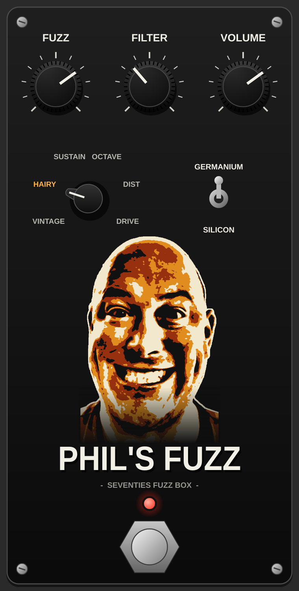

# Phil's Fuzz

A 70s-style fuzz Audio Unit (and VST3) for Ableton Live, with a stomp-box interface.



## Controls

| Control | What it does |
|---------|--------------|
| **Fuzz** | How hard the circuit is driven. |
| **Filter** | Works like a RAT filter: turning it up makes the tone darker (14 kHz down to about 450 Hz). |
| **Volume** | Output level. |
| **Mode** | Six circuit types (turn the pointer knob or click a label). |
| **Germanium / Silicon** | Germanium is softer, warmer and sputters as notes fade. Silicon is louder, brighter and harder-edged. |
| **Footswitch** | Bypass with a short crossfade. The red LED is lit when the effect is on. |

### Modes

| Mode | Sound |
|------|-------|
| **Vintage** | A single, wide-open transistor fuzz. Raw and splatty. |
| **Hairy** | Lopsided transistor stage into a diode clipper. The original Hairy Fuzz sound. |
| **Sustain** | Two cascaded clipping stages and a scooped tone stack. Thick, singing sustain. |
| **Octave** | Rectified fuzz that adds a ringing octave up. Best on lead lines above the 12th fret. |
| **Dist** | Op-amp gain into hard clipping diodes. Tighter, more modern distortion. |
| **Drive** | Low-gain, soft overdrive. |

The circuit runs at 4x oversampling, and mode or diode changes crossfade instead of clicking.

## Getting the plugin

Every push builds the plugin on a GitHub Mac runner and checks it with Apple's `auval`.
Open the **Actions** tab, click the newest green run, and download **PhilsFuzz-macOS**
from the Artifacts section. Then follow `INSTALL.txt` inside the zip.

## Building yourself (macOS)

```sh
cmake -B build -DCMAKE_BUILD_TYPE=Release -DCMAKE_OSX_ARCHITECTURES="arm64;x86_64"
cmake --build build --config Release
```

The plugin bundles land in `build/PhilsFuzz_artefacts/Release/`.

Built with [JUCE](https://juce.com) (downloaded automatically by CMake).
